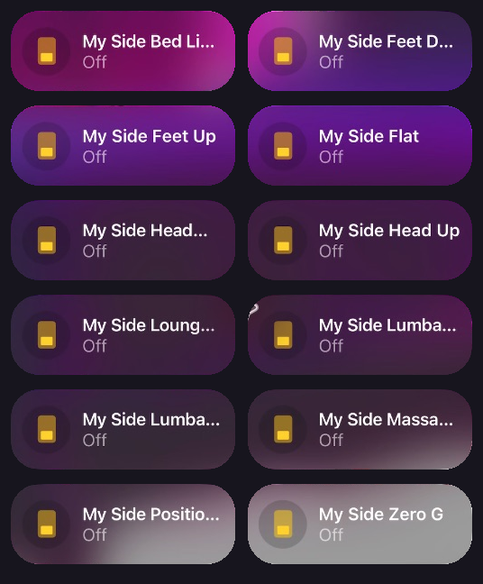
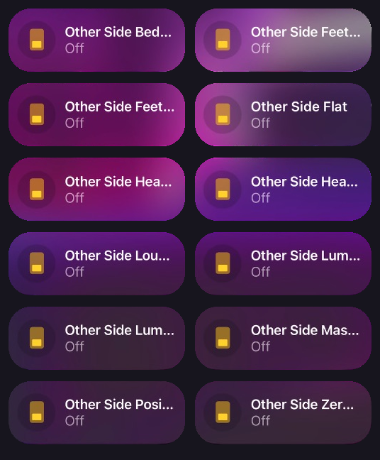
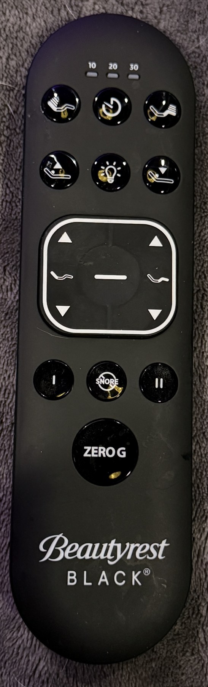

# Beautyrest Local for Homebridge

[](https://github.com/reboot-digital/homebridge-beautyrest-local/actions/workflows/test.yml)

**Your adjustable bed, in Apple Home. Local control. No relay subscription.**

Control one base or two independently paired sides of a compatible Beautyrest adjustable bed from Apple Home, Siri, and HomeKit scenes. Beautyrest Local sends commands directly to the bed’s Wi-Fi controllers on your home network. It does not need Alexa, a cloud account, or a subscription.

Built and maintained by **RebootDigital**. This is an independent community project, not an official Beautyrest, Keeson, Ergomotion, Apple, or Homebridge product.

[☕ Buy me a coffee](https://buymeacoffee.com/rebootdigital) · [Installation](#installation) · [Compatibility](#compatibility) · [Controls](#controls) · [Troubleshooting](#troubleshooting) · [Report an issue](https://github.com/reboot-digital/homebridge-beautyrest-local/issues)

## In Apple Home

Real iPhone screenshots from the original working installation, with the surrounding home and room photo removed. These show the existing personal control names; version 1.2.0 and later call the saved preset **Position 1**, rather than “Lounge.” Apple Home may shorten longer tile labels.

<p>
  
  
</p>

**Every tile is a button, not a status indicator.** Switches return to Off after a command. Off does not mean that the bed is flat, its light is off, or massage is stopped.

### Physical remote reference



The remote used with the tested setup. The photo is cropped and its location metadata removed. See the [remote button coverage table](docs/REMOTE-CONTROLS.md) for supported functions and remaining differences. A matching remote does not establish controller compatibility.

## Compatibility

See the [model compatibility table and support-request process](docs/COMPATIBILITY.md). Requests are welcome; hardware access or a volunteer tester may be needed, and support is not guaranteed.

Physically tested on **one Beautyrest Black king bed with two independently controlled bases**, configured using the Beautyrest Black app. Both sides’ light toggles, Flat, Zero G, manual head/feet/lumbar adjustments, and massage start/stop were confirmed. Saved-position buttons sent commands and produced movement; the recalled position depends on what is stored in each base. Preset accuracy was not confirmed for every side and preset.

Other beds are **unconfirmed**, including other Beautyrest models and other Keeson/Ergomotion products. Matching brand names alone do not establish compatibility. The controller must advertise `_keeson._tcp` with a `bedinfo.device_id` and support the TCP command/status protocol on port 5000. Bluetooth-only bases are not supported.

Requirements:

- Homebridge **1.8.x or later 1.x**, or **2.x**; an existing Apple Home setup.
- Node.js **20 or later**. Prefer a [currently supported Homebridge Node.js version](https://github.com/homebridge/homebridge/wiki/How-To-Update-Node.js).
- The bed already connected to Wi-Fi using its normal app.
- IPv4 connectivity from Homebridge to the controllers, plus mDNS/multicast discovery. Guest isolation and separate VLANs can prevent discovery.

A Home hub is needed for remote access and HomeKit automations under Apple’s normal requirements. The plugin itself sends commands only over the local network.

## Installation

The distribution package is named **`homebridge-beautyrest-local`** and the platform is **`BeautyrestLocal`**.

### GitHub release download

Download the `.tgz` package from [Releases](https://github.com/reboot-digital/homebridge-beautyrest-local/releases). On the Homebridge host, install the downloaded package with npm using your installation’s normal permissions:

```sh
npm install -g ./homebridge-beautyrest-local-1.3.0.tgz
```

Restart Homebridge after adding configuration below. Do not install a second copy alongside an existing local copy.

### Homebridge plugin search / npm

The plugin is distributed on [npm](https://www.npmjs.com/package/homebridge-beautyrest-local). Search Homebridge UI for `homebridge-beautyrest-local`, or install from npm:

```sh
npm install -g homebridge-beautyrest-local@1.3.0
```

If npm reports “Not found,” use the GitHub release package above. Homebridge search depends on npm publication and indexing, so search results can lag the first release. A GitHub release alone does not establish that the package is indexed.

This project does not currently claim Homebridge Verified status.

## Find your controller IDs

The plugin discovers each base by its controller ID, so you do not need a fixed IP address. Each ID has **12 hexadecimal characters**. On the Homebridge host, after installing the package, run:

```sh
beautyrest-discover
```

This listens to local mDNS advertisements for 10 seconds. It never sends a bed command. Keep the reported IDs private.

For manual discovery on macOS, `dns-sd -B _keeson._tcp local.` lists services; resolve each advertised service with `dns-sd -L "SERVICE NAME" _keeson._tcp local.` and look for `bedinfo` → `device_id`. Press Control-C to stop browsing. Do not assume a controller ID is the same as a printed serial number or Wi-Fi MAC address.

With two bases, the order in discovery does not identify the physical side. Match IDs using your own app/controller information. If identification needs a command test, do it in person with the bed clear and the physical remote available.

## Configuration

In Homebridge UI, open **Beautyrest Local → Settings** and add one or two sides. Use short names such as **My Side** and **Other Side**, or **Left Bed** and **Right Bed**. Save and restart Homebridge. For an isolated setup, use the UI’s child bridge option and pair that bridge in Apple Home.

Example platform entry for `config.json` (replace both example IDs):

```json
{
  "platform": "BeautyrestLocal",
  "name": "Beautyrest Local",
  "sides": [
    { "name": "My Side", "id": "aabbccddeeff" },
    { "name": "Other Side", "id": "112233445566" }
  ]
}
```

These IDs are placeholders. Add this object to your existing `platforms` array; do not replace your full Homebridge configuration. For one base, keep just one side entry. Names must be nonempty and controller IDs unique.

The plugin creates **14 switch accessories per side**, for 14 or 28 controls total. Move them to a dedicated room, such as **ErgoBed**, in Apple Home. Accessory identities are based on controller ID and command, so changing a side name keeps their identifiers. Apple Home can retain names you have customized there.

## Controls

| Button | Action |
| --- | --- |
| Bed Light Toggle | Toggles the under-bed light. It cannot reliably set or report On/Off. |
| Flat | Requests the controller’s Flat position. |
| Zero G | Requests the controller’s Zero G position. |
| Snore | Requests the controller’s Anti-Snore preset. |
| Position 1 | Recalls saved preset 1. The plugin does not save or overwrite it. |
| Position 2 | Recalls saved preset 2. The plugin does not save or overwrite it. |
| Head Up / Head Down | Brief head movement, then RELEASE. |
| Feet Up / Feet Down | Brief foot movement, then RELEASE. |
| Lumbar Up / Lumbar Down | Brief lumbar movement, then RELEASE. |
| Massage Toggle | Reads both motors; starts both if both are off, otherwise attempts to turn both off. |
| Massage Timer Cycle | Advances the controller’s built-in massage timer, like the remote’s timer button. It does not select a known duration from HomeKit. |

Manual adjustments use a **650 ms nudge** followed by RELEASE. This is not hold-to-move control. The plugin rejects overlapping commands to the same side; wait for the button to reset before pressing another. Different sides can operate independently.

Position and Flat/Zero G commands ask the base to run its own movement routine. There is no position percentage, motion sensor, obstruction detection, or separate emergency-stop accessory. Keep the normal remote available. A network failure can prevent delivery of RELEASE; the plugin attempts a fresh stop connection after a failed manual adjustment, but cannot guarantee a stop over a broken network.

### Siri and scenes

Because the controls are switches, Siri requests take the form **“Turn on My Side Flat.”** For a more natural phrase, create an Apple Home scene called **Bed Flat** that turns on the desired Flat switch(es), then say **“Set Bed Flat.”**

Use explicit positions for predictable scenes. Light and massage are toggles: repeating a scene containing them can reverse the previous result. Massage Timer Cycle also advances a selection, so it is best used as a button; HomeKit does not show the selected timer duration. Turning a switch Off does not send a bed command. Avoid unattended or repeating movement automations.

## Troubleshooting

| Symptom | Check |
| --- | --- |
| No controls after restart | Configure one or two sides with distinct 12-character hexadecimal IDs and nonempty names. Check the Homebridge log. |
| Communication failure | Confirm power/Wi-Fi, the controller ID, mDNS access and TCP 5000 connectivity from the Homebridge host. Fixed IPs do not replace discovery. |
| A button shows Off immediately | Expected: switches are momentary and do not show the physical state. |
| Another command is rejected | Wait for the current same-side command and reset to finish. |
| Position 1 looks like Flat | Check the preset saved on that particular base. “Position 1” does not guarantee Lounge. |
| Light scene behaves inconsistently | It is a toggle, without reliable state. Use it as a button rather than a stateful light. |
| A feature does nothing | Your controller or base may differ from the tested bed, or may lack that feature. Report the model and symptom. |
| Old controls remain | Check for a second plugin installation or platform entry. Back up Homebridge before removing cached accessories. |

If movement does not stop as expected, use the physical remote and stop testing. Do not repeatedly retry commands to diagnose a moving bed.

## Privacy and networking

No telemetry, analytics, external API, cloud login, or subscription is used by the plugin. Runtime traffic consists of local mDNS discovery and TCP commands/status replies. Package installation and updates use npm/GitHub as usual. Controller IDs remain in your local Homebridge configuration and accessory serial numbers.

The controller protocol is unencrypted and the plugin adds no controller authentication. Use a trusted home network. Do not forward TCP port 5000 or expose Homebridge/controller services to the public internet.

Before sharing an issue or screenshot, remove controller IDs, IP addresses, HomeKit PINs/QR codes, household names, access tokens, and your full `config.json`. Report only the model, app name, plugin/Homebridge/Node versions, command attempted, and a redacted error description.

## Development

```sh
npm ci --ignore-scripts
npm run check
npm test
npm pack --dry-run
```

Tests use fake mDNS advertisements, loopback TCP controllers, and real Homebridge/HAP accessory classes with the hardware transport replaced. They do not discover or operate your bed. Tests cover framing, invalid responses, timeouts, movement release/recovery, massage progression, same-side concurrency, cached accessories, momentary resets, and configuration validation.

Physical experience is limited to the single split bed described above. Version 1.2.0’s transport changes were covered by automated tests. For version 1.3.0, the owner confirmed Snore’s expected position and stopping, plus normal native timer-button behavior, on My Side. Exact timer-duration selection/expiry and the new controls on the second side were not separately verified. See the remote coverage table.

## Support the project

If Beautyrest Local makes your setup easier, you can [buy RebootDigital a coffee](https://buymeacoffee.com/rebootdigital) to support future development. Donations are optional; the plugin is free and all features remain available to everyone.

## License

[MIT](LICENSE) © 2026 RebootDigital.
