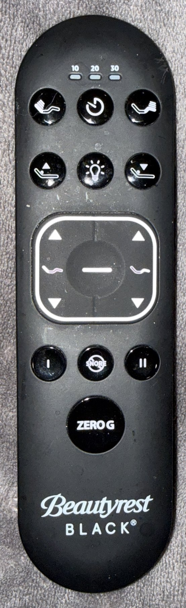

# Remote control coverage

This is the owner-provided Beautyrest Black remote used with the tested split-bed setup. Its photo helps identify the layout; it does not prove another controller uses the same protocol. Unique controller/base model and firmware details still matter.

| Physical remote function | Plugin control | Coverage |
| --- | --- | --- |
| Head up/down | Head Up / Head Down | Brief 650 ms nudges followed by RELEASE, rather than continuous hold. |
| Foot up/down | Feet Up / Feet Down | Brief 650 ms nudges followed by RELEASE. |
| Lumbar support up/down | Lumbar Up / Lumbar Down | Brief 650 ms nudges followed by RELEASE. |
| Under-bed light | Bed Light Toggle | Toggle; no reliable reported light state. |
| Flat | Flat | Native preset request. |
| ZERO G | Zero G | Native preset request. |
| I / II short press | Position 1 / Position 2 | Recall only; exact saved positions belong to each base. |
| SNORE | Snore, added in 1.3.0 | Owner confirmed the expected position and automatic stopping on My Side. |
| Timer clock / 10, 20, 30 indicators | Massage Timer Cycle, added in 1.3.0 | Owner confirmed native button behavior on My Side. No selected-duration display in HomeKit. |
| Separate head and foot massage buttons | Massage Toggle | Partial: plugin starts both motors if both are off, otherwise attempts to turn both off. Individual zones and intensity selection are not exposed. |
| Hold I / II to save positions | No plugin equivalent | Use the physical remote. The plugin does not overwrite presets. |

## Timer behavior

Massage Timer Cycle mirrors the remote button by asking the controller to advance its own timer selection. The controller handles the timing, independently of the Homebridge process. The plugin neither starts a Homebridge countdown nor assumes that one press always means 10 minutes.

The remote has 10/20/30-minute indicators. The plugin has not validated a reliable timer-status field for this controller, so it does not offer fixed 10-, 20- and 30-minute selectors, report a remaining duration, or promise a particular starting/cycling/off sequence. The manufacturer app did not update its displayed setting live during testing, so exact duration selection and expiry were not independently verified. A successful status reply confirms receipt of a recognized protocol frame, not the selected duration or physical pose.

Use the timer control as a button rather than a repeated scene action. The plugin does not automatically turn massage on before cycling its timer, nor repeat a timer command after a network failure. An uncertain command may already have reached the controller.

## Evidence and validation status

The manufacturer-authored [Beautyrest Black Luxury quick setup guide, remote diagram on page 3](https://jcpenney.scene7.com/is/content/jcpenneyimages/Beautyrest%20Black%20Luxury%20Quick%20Set%20Up%20Guidepdf) labels the Snore and massage timer controls. Its layout matches the pictured remote.

The native TCP command mapping was cross-checked against independent implementation evidence in [smartbed-mqtt's command constants](https://github.com/richardhopton/smartbed-mqtt/blob/2ea8b1d5d0dbbe58a806fca48aec7b2e5a8e69c9/src/Common/Commands.ts), [ErgoMotion preset mapping](https://github.com/richardhopton/smartbed-mqtt/blob/2ea8b1d5d0dbbe58a806fca48aec7b2e5a8e69c9/src/ErgoMotion/setupPresetButtons.ts), and [massage control mapping](https://github.com/richardhopton/smartbed-mqtt/blob/2ea8b1d5d0dbbe58a806fca48aec7b2e5a8e69c9/src/ErgoMotion/setupMassageButtons.ts). This is protocol evidence, not physical compatibility confirmation for every controller.

Automated tests confirm the exact commands, one-shot behavior, errors without replay, momentary resets, same-side exclusion, and preservation of existing accessories during upgrade. During supervised testing, the owner confirmed that Snore on My Side recalled the expected position and stopped on its own. The native timer command was sent twice on My Side; the owner observed massage starting and confirmed the timer button appeared to behave normally. The app did not update live. Exact 10/20/30-minute selections, full timed expiry and these new commands on the second side remain unverified. Massage-off behavior for status levels up to six is covered by fake-controller tests; the highest physical massage intensities were not newly tested.
